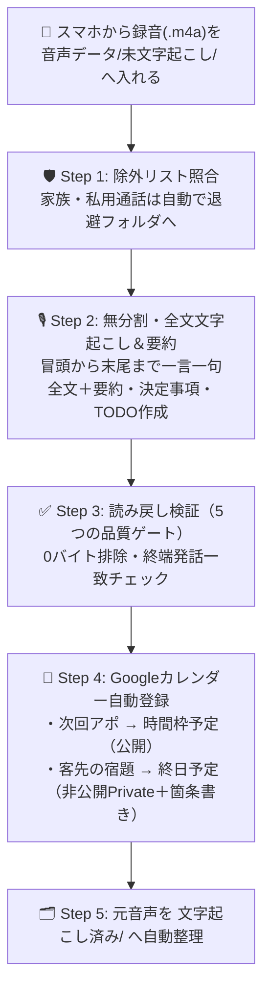

# 🎙️ Antigravity 全自動・音声文字起こし＆Googleカレンダー連携パック

**「スマホの通話録音・商談録音をフォルダに入れるだけ」**  
毎晩寝ている間にAI（Google Antigravity）が**無分割で最初から最後まで一言一句文字起こし＆要約**を作成し、さらに会話内の**「次回アポ（時間枠予定）」**と**「お客様からの宿題（自分だけ見える非公開の終日予定＋箇条書きTODO）」**をGoogleカレンダーへ全自動登録するスターターパッケージです。

---

## ✨ このパッケージの3大特徴

1. **長尺音声も分割不要・1文字も漏らさず全文取得**
   - 10分を超える長尺の通話・商談でも5分刻みの分割は不要。冒頭から末尾の挨拶（「失礼します」等）まで省略なしで逐語全文と要約を同時生成します。
2. **追加API課金ゼロ（Whisper不使用）**
   - Antigravity内蔵のマルチモーダル音声認識（Gemini 3.8）が原音声を直接聴取するため、外部APIキーの発行や従量課金は一切かかりません。
3. **商談アポ＆「非公開の宿題」をGoogleカレンダーへ自動登録**
   - **🕒 アポイント（商談・訪問・打合せ）**：時間指定イベント（例：`14:00〜15:00 【アポ 商談】株式会社サンプル商事`（用件と担当者は説明欄））として自動登録。
   - **🔒 お客様からの宿題（やること）**：社内共有カレンダーでも他の社員に中身が見えないよう、**非公開（Private）の終日予定**として見出しをタイトルに登録し、メモ欄にやることをすべて箇条書きで記載します。

---

## 🚀 1分で完了！一発セットアップ手順

### 方法A：ZIPダウンロード（または `git clone`）してAntigravityで開くだけ【一番簡単】

1. このページの右上にある緑色の **`<> Code`** ボタン → **`Download ZIP`** を押して解凍します（または以下をターミナルで実行）。
   ```bash
   git clone https://github.com/ozikouta-design/antigravity-voice-calendar-pack.git
   ```
2. 解凍したフォルダを **Google Antigravity** でワークスペースとして開きます（必要なフォルダ階層・ルール・スキルはすべて最初から入っています）。
3. Antigravityのチャット欄で以下の一言を送るだけで初期設定〜毎夜自動実行の登録まで完了します！

```text
私の名前は「山田」です。文字起こしパックの初期設定と、毎夜01:00の自動実行スケジュール登録をしてください。
```

> 💡 **事前準備（1回だけ）**：Antigravityのチャット欄で `/plugin` と入力し、**Google Calendar（gcalendar）** プラグインを有効化してGoogleアカウントと連携しておいてください。

---

### 方法B：セットアップスクリプト（`setup.sh`）で一発導入

ターミナルから以下のコマンドを実行すると、あなたの名前（話者ラベル）の自動反映と、Antigravityグローバルプラグインとしての登録まで対話式で一発完了します。

```bash
chmod +x setup.sh && ./setup.sh
```

---

## 📱 日常の使い方（あなたがやることは1つだけ）

1. スマホやICレコーダーの録音ファイル（`.m4a` 等）を **`音声データ/未文字起こし/`** フォルダに入れます（Googleドライブ同期フォルダにしておくとスマホから直接アップロードできます）。
2. **あとは放置でOK！** 毎晩01:00に自動で以下が実行されます（今すぐ動かしたい時はチャットで「**未文字起こしを処理して**」と送るだけ）。



---

## 📂 フォルダ構成（クローンした時点で全て揃っています）

```text
.
├── AGENTS.md                                 # Antigravityが自動読込するプロジェクトルール
├── plugin.json                               # プラグインマニフェスト
├── setup.sh                                  # 1コマンド初期設定スクリプト
├── .agents/skills/voice-transcription/       # ワークスペース用スキル定義
├── skills/voice-transcription/               # プラグイン用スキル定義
├── docs/index.html                           # スマホ対応ビジュアルガイド（PDF保存可）
├── 音声データ/
│   ├── 未文字起こし/                         # ★ここにスマホから録音ファイルを入れるだけ！
│   └── 文字起こし済み/                       # 処理完了後の元音声が自動移動される保管庫
│       ├── 通話音声/
│       └── 録音データ/
└── _brain/
    ├── 録音全文/                             # ★一言一句すべての逐語全文（.md）が保存される場所
    ├── 通話要約/                             # ★要約・決定事項・TODO（.md）が保存される場所
    ├── 通話_除外リスト.txt                   # 家族・プライベート等、文字起こししない相手名リスト
    └── 運用/
        ├── 夜間文字起こし運用ルール.md       # 運用ルールの正本
        └── 外部ソース台帳/                   # カレンダー登録履歴台帳（CALENDAR_MATCH_INDEX.jsonl）
```

---

## 🛡️ 5つの品質ゲート（Quality Gates）

「長い音声の後半が勝手に省略される」「空ファイルのまま元音声が移動される」といった事故を防ぐため、以下の5項目すべてに合格した音声のみ完了扱いとなります。

| 品質ゲート項目 | 判定基準 |
| :--- | :--- |
| `AUDIO_ID_MATCH = true` | ファイル名・通話相手名・録音日時の完全一致 |
| `TRANSCRIPT_COMPLETE = true` | 冒頭から終端までの通話全区間を無分割で網羅（途中終了・要約代用は不合格） |
| `TERMINAL_VERIFIED = true` | 末尾の発話（「失礼します」「お疲れ様です」等）が実音声の終端と一致 |
| `PERSISTENCE_VERIFIED = true` | 保存直後の再読込（読み戻し）による実体確認（0byte・文字化けの排除） |
| `CALENDAR_SYNC_VERIFIED = true` | アポイント（時間指定）および顧客宿題（非公開終日予定）の登録・台帳反映確認 |

---

## ❓ よくある質問（FAQ）

- **Q. 社内共有カレンダーを使っていますが、お客様からの細かい宿題を他の社員に見られたくありません。**
  - A. お客様からの宿題（TODO）は公開設定を `private`（非公開）にした終日予定として登録されます。他の社員のカレンダーには「予定あり（非公開）」としか表示されず、あなた本人にだけタイトルと箇条書きのメモが見えます。
- **Q. 家族やプライベートの通話録音が混ざったらどうなりますか？**
  - A. `_brain/通話_除外リスト.txt` に相手の名前を1行ずつ書いておけば、文字起こしやカレンダー登録を行わずに自動で `業務外除外_YYYYMMDD/` フォルダへ安全退避します。
